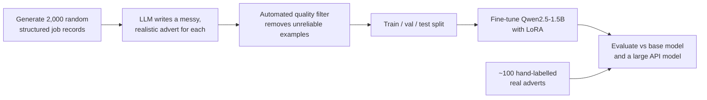

# JobParse-Small 🧩

**Can a small, cheap language model beat a much larger one at a specialised task?**

This project fine-tunes a 1.5-billion-parameter open model ([Qwen2.5-1.5B-Instruct](https://huggingface.co/Qwen/Qwen2.5-1.5B-Instruct)) with LoRA to turn messy, real-world job adverts into clean, structured JSON, and rigorously compares it against the same model before training and a large general-purpose model accessed through an API.

> ⚠️ **Results are not filled in yet.** Replace every `TODO` in this README with your real numbers and findings once you've run the experiments.

---

## The problem

Job adverts are written in every style imaginable: formal listings, casual LinkedIn posts, recruiter emails full of typos. Salaries appear as "£45,000 per annum", "45-50k" or "up to 50 grand". Key details are often missing or buried in paragraphs of company waffle.

Turning that text into structured data (job title, location, salary range, skills and so on) is a common real-world task. Large models handle it well, but they are slow and expensive to run at scale. Small, specialised models could do the same job far more cheaply, if they can be trained to be accurate enough.

## Approach



### Key design decisions

**1. Labels that are correct by construction.** Instead of hand-labelling thousands of adverts, the pipeline works backwards: it generates the structured JSON *first*, then asks an LLM to write a realistic advert containing exactly those details, in a randomly chosen style. Every training label is therefore known to be correct.

**2. An automated quality filter.** The generator LLM doesn't always follow instructions. It sometimes forgets a detail or invents one (like a city for a job that has none). `split_data.py` detects these cases and removes them, so the model never learns from bad examples. TODO: report how many were removed and the most common issues.

**3. A real-world test set.** Synthetic data can flatter a model. To check that it generalises, the final evaluation also uses ~TODO genuine job adverts that I labelled by hand. These aren't included in the repo because the adverts belong to the sites that published them.

**4. Loss only on the answer.** Training uses TRL's prompt-completion format, so the model is only trained to produce the JSON, not to reproduce the advert.

**5. A fair comparison.** All models receive exactly the same prompt, and failed or invalid outputs count as wrong for every field, so no model can score well by refusing difficult cases.

## Results

TODO: paste the tables from `results/results.md` here.

**Synthetic test set (TODO adverts)**

| Model | Valid JSON | Field accuracy | Skills F1 | All fields correct | Time per advert |
|---|---|---|---|---|---|
| Qwen2.5-1.5B (base, no fine-tuning) | TODO | TODO | TODO | TODO | TODO |
| Qwen2.5-1.5B + LoRA (this project) | TODO | TODO | TODO | TODO | TODO |
| Large API model (TODO: name) | TODO | TODO | TODO | TODO | TODO |

**Real-world test set (TODO hand-labelled adverts)**

| Model | Valid JSON | Field accuracy | Skills F1 | All fields correct |
|---|---|---|---|---|
| Qwen2.5-1.5B (base) | TODO | TODO | TODO | TODO |
| Qwen2.5-1.5B + LoRA | TODO | TODO | TODO | TODO |
| Large API model | TODO | TODO | TODO | TODO |

### What I found

TODO: write 3–5 honest bullet points, for example:
- How much fine-tuning improved the small model, and on which fields.
- Whether it matched or beat the large model, and at what cost difference.
- How much performance dropped from synthetic to real adverts, and why.
- The most common remaining mistakes (use `show_errors.py`), such as hourly vs annual salaries or skills mentioned only indirectly.

## Lessons learned

TODO: the most interesting part for readers. What went wrong, what surprised you, and what you'd do differently. For example: problems with the generated data, training settings that didn't work, or gaps between synthetic and real-world performance.

## Limitations and future work

- The synthetic adverts cover a fixed set of job titles, cities and skills, so the model may struggle with very different roles or industries.
- The real-world test set is small, so its results have wide uncertainty.
- Possible next steps: more varied training data, adding real adverts to training, testing even smaller models, and quantising the model to run on a CPU.

## Project structure

```
jobparse-small/
├── src/
│   ├── schema.py          # Output schema, prompt and JSON parsing (shared)
│   ├── make_records.py    # Step 1: generate random structured job records
│   ├── generate_ads.py    # Step 2: LLM writes a messy advert for each record
│   ├── split_data.py      # Step 3: quality filter + train/val/test split
│   ├── train_lora.py      # Step 4: LoRA fine-tuning (GPU)
│   ├── predict_local.py   # Step 5a: run the small model (base or fine-tuned)
│   ├── predict_api.py     # Step 5b: run the large-model baseline via API
│   ├── evaluate.py        # Step 6: score and compare models
│   ├── show_errors.py     # Error analysis: see what a model gets wrong
│   └── label_real.py      # Tool for hand-labelling real adverts
├── notebooks/
│   └── train_colab.ipynb  # Train and evaluate on a free Colab GPU
├── demo/
│   └── app.py             # Gradio web demo
├── data/                  # Generated datasets
└── results/               # Predictions and score tables
```

## How to run it

### 1. Set up (any laptop)

```bash
git clone https://github.com/YOUR_USERNAME/jobparse-small.git
cd jobparse-small
python -m venv .venv
.venv\Scripts\activate          # Windows  (macOS/Linux: source .venv/bin/activate)
pip install -r requirements.txt
```

Copy `.env.example` to `.env` and add an API key for any OpenAI-compatible provider.

### 2. Create the dataset

```bash
python src/make_records.py
python src/generate_ads.py --limit 20     # cheap test run first - read the adverts!
python src/generate_ads.py                # then the full 2,000
python src/split_data.py
```

### 3. Train on a GPU

Open `notebooks/train_colab.ipynb` in [Google Colab](https://colab.research.google.com/), choose a T4 GPU runtime and run the cells. Training the default settings takes roughly 20–40 minutes.

### 4. Run the large-model baseline

```bash
python src/predict_api.py --input data/test.jsonl --out results/preds_large.jsonl
```

### 5. Evaluate

```bash
python src/evaluate.py results/preds_base.jsonl results/preds_finetuned.jsonl results/preds_large.jsonl
python src/show_errors.py results/preds_finetuned.jsonl --n 5
```

### 6. Real-world test set (optional but recommended)

Save real adverts as `.txt` files in `data/real_ads/`, run `python src/label_real.py` to label them, then repeat steps 4–5 with `--input data/real_test.jsonl`.

### 7. Demo

```bash
pip install -r requirements-train.txt
python demo/app.py --adapter outputs/lora-jobparse
```

TODO: link to a live Hugging Face Space if you deploy one.

## Tech stack

Python · Hugging Face Transformers · TRL · PEFT (LoRA) · Datasets · OpenAI-compatible APIs · Gradio · Google Colab

## License

MIT
